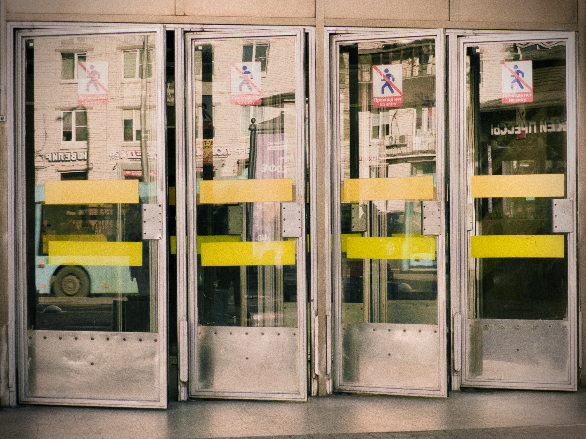
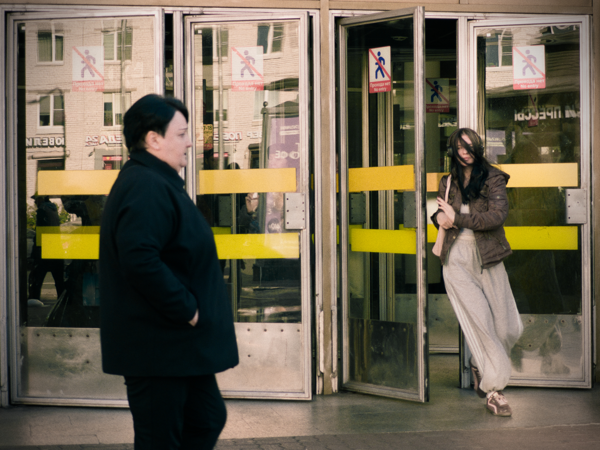
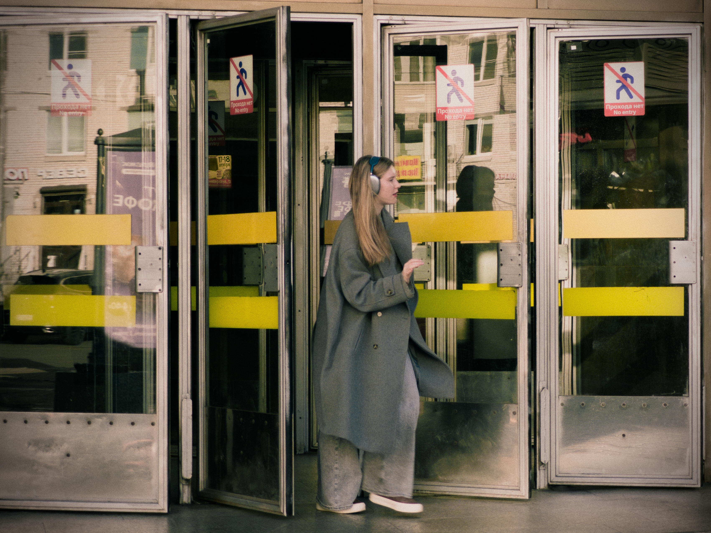
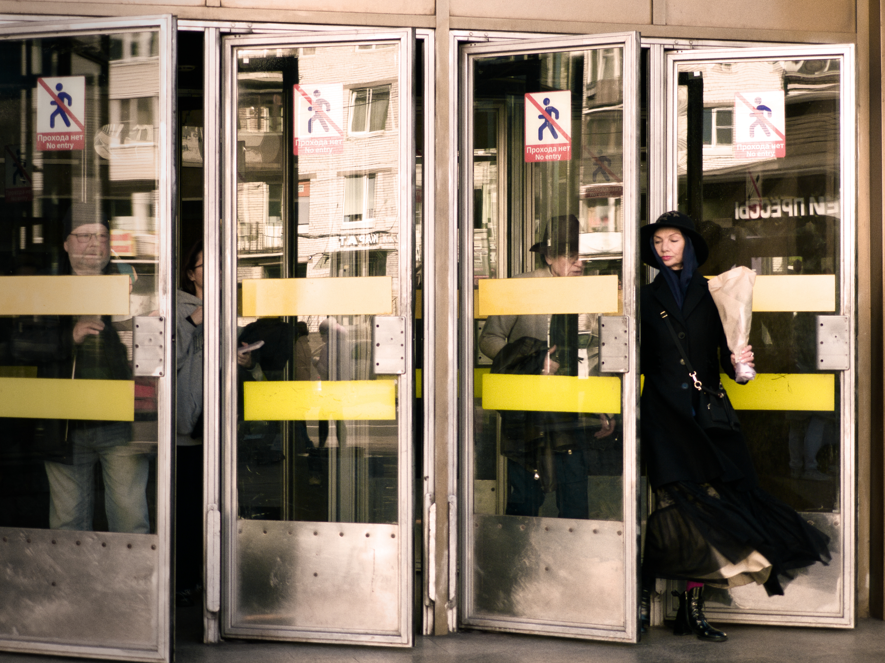

# No Entry (Прохода нет)

*A visual study of boundaries, reflections, and urban isolation.*

---

## The Series

*Кадр 1: Пустые двери, начало серии.*

*Кадр 4: Женщина в черном со шляпой и букетом, отражение мужчины в стекле, завершающий аккорд серии.*

---

## Deconstruction

Эта серия родилась из наблюдения за тем, как городские пространства диктуют нам правила движения, создавая невидимые, но ощутимые границы.

### По Майклу Фриману (Композиция)

- **Рамка в рамке:** Стекло и дверные проемы работают как естественные рамки, изолирующие субъекта и усиливающие чувство отчужденности.
- **Отражения как второй план:** Отражение мужчины в стекле создает визуальный конфликт: физическое присутствие vs его призрачный двойник.
- **Ведущие линии:** Архитектурные элементы направляют взгляд к центру, где происходит встреча взглядов (или их избегание).

### По Сьюзен Сонтаг (Контекст)

Это не просто документация улицы. Это исследование «обнаженности» городского пространства. Герои не позируют; они захвачены в моменте перехода. Двери, в которые «нет прохода», становятся метафорой: мы постоянно движемся сквозь город, но редко становимся его частью.

---

## The Kitchen (Техническая кухня)

- **Камера:** [Ваша камера, например: Xiaomi 14 Ultra]
- **Объектив:** [Например: 23mm f/1.8]
- **Настройки:** f/5.6, 1/250s, ISO 200
- **Свет:** Естественный, пасмурный день

### Постобработка в Darktable

1. **Съемка:** RAW-файл с минимальным внутренним контрастом
2. **Filmic RGB:** Мягкое сопоставление тонов для кинематографичной эстетики
3. **Color Balance RGB:** Легкий сдвиг теней в холодные тона
4. **Local Contrast:** Минимальное добавление микроконтраста

---

## Final Thought

Серии на алгоритмических платформах часто «ломаются», показывая зрителю только обложку. Этот проект создан здесь, чтобы вы могли увидеть всю историю целиком.

Иногда «Прохода нет» — это именно та точка, где начинается настоящая фотография.

---

*Tags: #streetphotography #urbanisolation #darktable #photographybreakdown*
